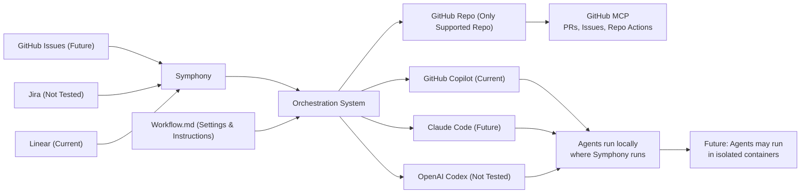

# Symphony .NET

A .NET 10 implementation of [OpenAI's Symphony](https://github.com/openai/symphony), an AI agent orchestration system

> [!WARNING]
> Symphony is prototype software intended for evaluation and development purposes
> For production deployments, implement your own hardened version

## Overview

Symphony is a web host for AI-powered agent orchestration. Start the app with `dotnet run --project src/Symphony` and open the site. A workflow file is not required to start.

The repository still contains the earlier candidate-polling runtime (Linear or Jira, isolated workspaces, Copilot SDK or Codex in [App Server mode](https://developers.openai.com/codex/app-server/)). That runtime is not registered at startup. Removing it is a later change.



## Getting Started

### Prerequisites

- .NET 10 SDK installed
- Linear or Jira API token, only if you are using the legacy tracker clients. Not required to start the web host.
- Codex app-server installed and available in PATH (when Codex is used)
- Copilot CLI is installed and configured (when Copilot is used, though its not used but configurations are picked by SDK)

### Setup

1. Clone the repository:
   ```bash
   git clone https://github.com/khurram-uworx/symphony
   cd symphony
   ```

2. Build the project:
   ```bash
   dotnet build Symphony.slnx
   ```

The legacy tracker clients read `LINEAR_API_KEY` when they run. Setting it is not part of starting the web host.

### Running Symphony

Start the web host. No workflow path is required:

```bash
dotnet run --project src/Symphony
```

Kestrel listens on `http://localhost:5080`. Open that address in a browser. `/` returns the MVC home page.

## Configuration

See [docs/CONFIG.md](docs/CONFIG.md) for the workflow configuration reference. A bundled sample workflow is available at [src/Symphony/WORKFLOW.md](src/Symphony/WORKFLOW.md). It is a sample file, not a launch argument.

### Web host database

The web host selects its database from `appsettings.json`, overridden by environment variables. SQLite is the default and does not need a server. Switching providers is configuration only; do not change code.

| `Database:Provider` | Connection string | Notes |
| --- | --- | --- |
| `sqlite` (default) | `ConnectionStrings:Sqlite` | Defaults to `Data Source=App_Data/symphony.db` when omitted |
| `sqlserver` | `ConnectionStrings:SqlServer` | Required. No default |
| `postgresql` | `ConnectionStrings:PostgreSQL` | Required. `postgres` and `npgsql` are provider aliases. `ConnectionStrings:Npgsql` is used only when `PostgreSQL` is not set |

Environment variables use `__` for nested keys: `Database__Provider`, `ConnectionStrings__SqlServer`, `ConnectionStrings__PostgreSQL`.

A missing SQL Server or PostgreSQL connection string fails at startup. The error names the missing key and the configured provider. Provider-specific migrations are not part of this registration; schema initialization still uses the existing startup path.

### Workflow File Format

Create a WORKFLOW.md file with YAML front matter and a Markdown prompt body:

```markdown
---
tracker:
  kind: linear
  project_slug: "YOUR_PROJECT_SLUG"
workspace:
  root: ~/symphony/workspaces
hooks:
  before_run: |
    # Optional setup commands
  after_run: |
    # Optional cleanup commands
agent:
  max_turns: 20
codex:
  command: codex app-server
---

You are working on a Linear issue {{ issue.identifier }}.

**Title:** {{ issue.title }}

**Description:** {{ issue.description }}

Please analyze the issue and implement a solution.
```

### Configuration Options

- **tracker.kind**: Set to linear
- **tracker.project_slug**: Your Linear project slug (found in project URL)
- **tracker.api_key**: Defaults to LINEAR_API_KEY environment variable
- **workspace.root**: Root directory for issue workspaces (expands ~)
- **agent.max_turns**: Maximum consecutive turns per agent invocation (default: 20)
- **hooks.before_run**: Shell commands to run before starting the agent
- **hooks.after_run**: Shell commands to run after agent completion
- **codex.command**: Command to launch Codex app-server

### Template Variables

The workflow prompt supports the following template variables:

- {{ issue.identifier }}: Issue key (e.g., "PROJ-123")
- {{ issue.title }}: Issue title
- {{ issue.description }}: Issue description
- {{ issue.state }}: Current state of the issue

## Project Structure

```
src/Symphony/                    # Web host
├── Program.cs                    # ASP.NET Core entry point
├── Controllers/                  # MVC controllers
├── Views/                        # MVC views
├── Agent/                        # Copilot SDK and Codex runners
├── Config/
├── Domain/
├── IssueTracker/                 # Linear and Jira
├── Orchestration/                # Legacy polling runtime, not started by the web host
├── Workflows/
├── Workspaces/
└── Utils/
tests/
├── Symphony.Tests/               # NUnit suite (CI)
├── Symphony.CodingAgentsProbe/   # Manual Copilot SDK probes (not CI)
└── Symphony.PerformanceTests/    # Manual performance harness (not CI)
docs/
├── CONFIG.md
├── adr/                          # Accepted architecture decisions
└── plans/                        # Product and implementation plans
```

## Environment Variables

- **LINEAR_API_KEY**: Linear or Jira personal API token (used by the legacy tracker clients; not required to start the web host)
- **SYMPHONY_WORKSPACE_ROOT**: Override default workspace root directory

## Development

### Building

```bash
dotnet build Symphony.slnx
```

### Running Tests

The NUnit suite is the only project intended for CI:

```bash
dotnet test tests/Symphony.Tests
```

`tests/Symphony.CodingAgentsProbe` and `tests/Symphony.PerformanceTests` are manual. Do not treat them as part of CI.

```bash
dotnet run --project tests/Symphony.CodingAgentsProbe -- copilot "Say hello in one sentence."
dotnet run -c Release --project tests/Symphony.PerformanceTests
```

Architecture decisions live in [docs/adr/](docs/adr/). Product plans live in [docs/plans/](docs/plans/).

### Code Style

The project uses C# latest language features with:
- Implicit usings enabled
- Nullable reference types enabled
- Latest C# language version

## How It Works

### Agent Lifecycle

The steps below describe the legacy polling runtime. `dotnet run` does not start it.

1. **Poll**: Continuously monitors Linear for unstarted issues
2. **Prepare**: Creates a dedicated workspace directory and runs setup hooks
3. **Execute**: Launches Codex app-server and executes the workflow prompt
4. **Iterate**: Manages multi-turn conversations until work is complete
5. **Cleanup**: Runs cleanup hooks and monitors for terminal states

### Workspace Management

Each issue gets an isolated workspace where:
- The target repository is cloned (via hooks.before_run)
- All agent interactions are sandboxed
- Changes can be committed and pushed back to the repository
- Cleanup occurs after the agent completes

### Error Handling

The system gracefully handles:
- Workspace creation failures
- Hook execution failures
- Codex session failures
- Agent turn errors

All errors are logged with context for debugging.

## Contributing

Contributions are welcome! Please ensure:
- Code builds without warnings
- Tests pass
- Code follows the existing style conventions

## License

This project is licensed under the [Apache License 2.0](LICENSE)
